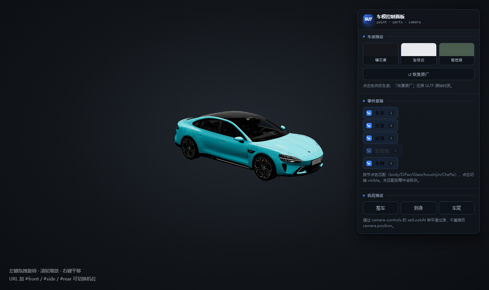
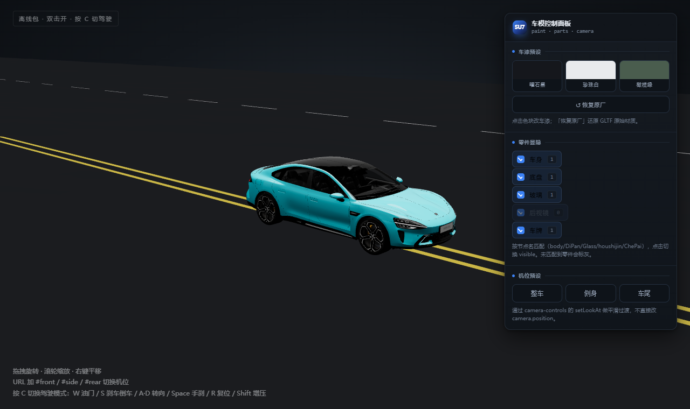
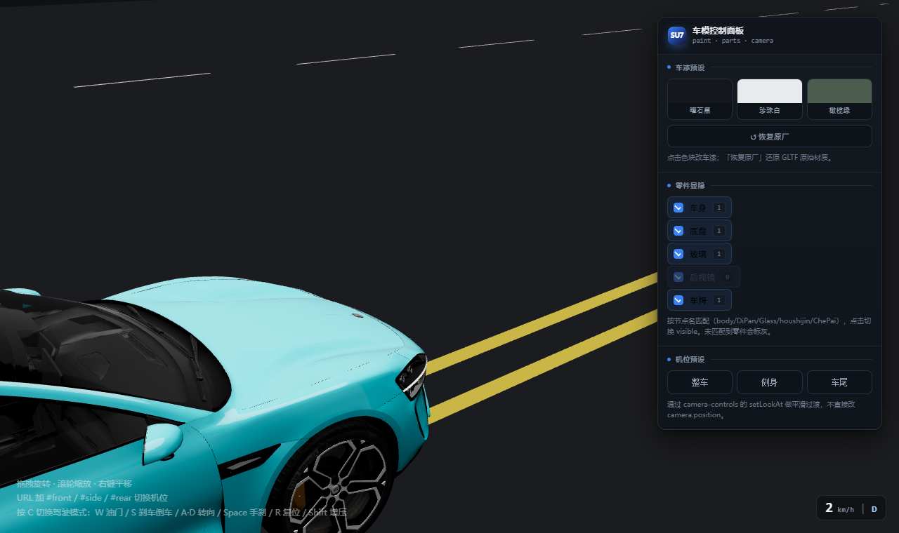
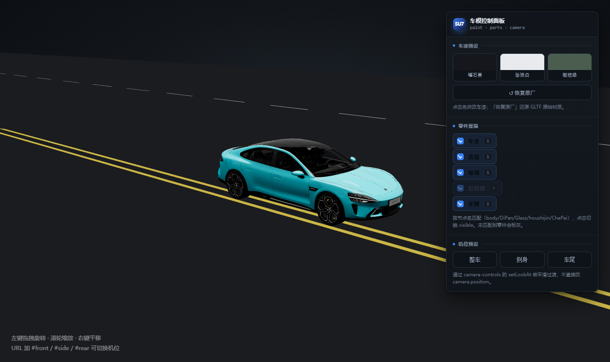
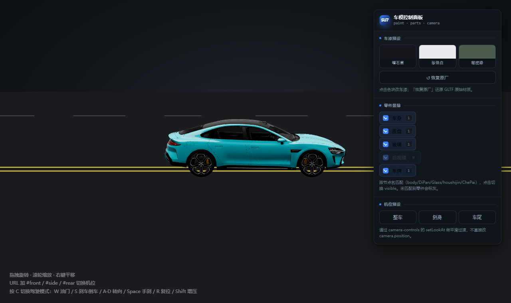

# 小米 SU7 车模 · 离线驾驶版

一个用 WebGL（three.js）实时渲染的小米 SU7 三维车模，纯前端、单 HTML 文件，three.js 已内联，**无需联网、无需安装、双击即开**。



## 功能

- **车漆预设**：曜石黑 / 珍珠白 / 橄榄绿，一键恢复原厂色
- **零件显隐**：车身、底盘、玻璃、后视镜、车牌逐个开关，支持"拆解"观察
- **机位预设**：整车 / 侧身 / 车尾，平滑过渡；也可用 URL `#front` `#side` `#rear` 直接切换
- **驾驶模式**：按 `C` 进入，`W` 油门 · `S` 刹车/倒车 · `A/D` 转向 · `空格` 手刹 · `R` 复位 · `Shift` 漂移，带速度 / 档位 HUD
- **无限路面场景**：行驶状态下车道线无限延伸
- **鼠标交互**：左键旋转 · 滚轮缩放 · 右键平移

## 快速体验

直接双击 `小米SU7车模-离线驾驶版.html`，浏览器打开即可，无需任何依赖。

## 效果预览

| 静态展示 | 驾驶模式 |
|---|---|
|  |  |

| 无限路面 | 侧身机位 |
|---|---|
|  |  |

## 开发接入

`panel-bridge.ts` 与 `car.html` 属于原 `su7-replica` 项目：

```bash
# 将 panel-bridge.ts 放到 src/，car.html 放到项目根目录后：
npx vite --port 5199
# 打开 http://localhost:5199/car.html
```

右上角 `#panel` 即显示控制面板（车漆 / 零件显隐 / 机位预设）。

## 文件说明

| 文件 | 说明 |
|---|---|
| `小米SU7车模-离线驾驶版.html` | 完整离线版，单文件可直接打开 |
| `car.html` | 车模页面（开发版，插入 panel-bridge 的挂载行） |
| `panel-bridge.ts` | 控制面板源码，挂在 `#panel` 上 |
| `*.png` | 各机位 / 场景的预览截图 |
